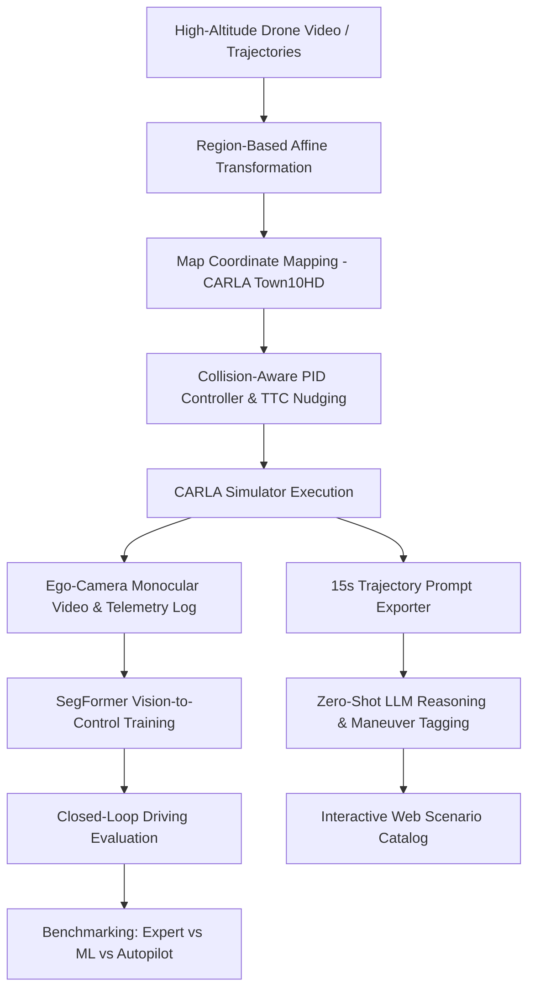

# While in London do as the Gwaliorites do: Style Transfer of Trajectories across Traffic Domains in Real-to-Sim

[](raj_vamsi_wafr.pdf)
[](https://www.python.org/)
[](https://carla.org/)
[](https://pytorch.org/)

Official repository for the research paper: **"While in London do as the Gwaliorites do: Style Transfer of Trajectories across Traffic Domains in Real-to-Sim"** by **Dasari Raj Vamsi** and **Rahul Kala** (*Center for Autonomous Systems, ABV-Indian Institute of Information Technology and Management Gwalior, India*).

---

## 📌 Abstract & Overview

Autonomous driving (AD) systems are primarily developed and evaluated under American and European traffic environments, where rule-following behavior is standard and aggressive driving is rare. In contrast, traffic in developing regions (such as Gwalior, India)—characterized by heavy-tail behaviors, frequent overtaking, heterogeneous vehicle mix, and lack of strict lane discipline—is underrepresented.

This project introduces a **Real-to-Sim Style Transfer Framework** that transfers unorganized, aggressive real-world traffic trajectories recorded by high-altitude drones in India into simulated European/American urban environments (CARLA simulator, Town10HD). 

### Key Technical Highlights:
1. **Map-Aware Affine Transformation**: Maps real-world drone pixel coordinates to simulator map coordinates across multi-directional traffic regions (North, South, East, West).
2. **Collision-Aware PID Controller**: Solves physical size, geometry, and vehicle dynamics discrepancies by combining Time-to-Collision (TTC) metrics with lateral trajectory nudging.
3. **Synthetic Ego-Centric Dataset Generation**: Synchronizes monocular camera views with control actions (`[speed, steering]`) under realistic heavy-tailed traffic scenarios.
4. **Zero-Shot LLM Reasoning**: Utilizes pre-trained LLMs to classify 15-second trajectory segments into maneuver categories without explicit fine-tuning.
5. **Vision-Based Behavioral Cloning (SegFormer)**: Trains a `BehavioralCloningSegFormer` model (`nvidia/mit-b0` encoder) for end-to-end autonomous steering and velocity control.
6. **Triple-Baseline Benchmarking Harness**: Compares performance across **Ground Truth Expert (Replay)**, **ML (SegFormer)**, and **CARLA Autopilot (Traffic Manager)** across 100 scenario categories.

---

## 🏗️ System Architecture



---

## 📁 Repository Structure

```
.
├── README.md                              # Main documentation (this file)
├── requirements.txt                       # Python dependencies
├── start_carla.sh                         # CARLA 0.9.15 simulator launcher script
├── run_sample_test_pipeline.sh            # 1-command zero-shot LLM & video rendering pipeline
│
├── Real2Sim Trajectory & Map Alignment
│   ├── timemethod.py                      # Region-based affine transformation matrices & geometry
│   ├── newtimemethod.py                   # Refined transformation matrices for Town10HD
│   ├── convertion.py                      # Affine matrix pre-computations
│   ├── automatic.py                       # Automated region coordinate transforms
│   └── prepare_data.py                    # Preprocessing raw drone trajectory CSV/JSON inputs
│
├── Trajectory Mining & Dataset Generation
│   ├── mine_15s_drone_catalog.py          # Mines 15-second trajectory windows from drone logs
│   ├── mine_unique_ego_catalog.py         # Filters catalog into 10 maneuver classes (overtaking, lane change, etc.)
│   └── mine_massive_catalog.py            # High-density region track miner
│
├── Simulation & Control Engine
│   ├── scc.py                             # Core vehicle simulation, route interpolation, & PID controller
│   ├── scenario_generator.py              # Spawns vehicles & configures trajectory replays
│   ├── simulate_and_record_scenarios.py   # Runs simulation, applies TTC collision avoidance, records camera & control logs
│   ├── SCENARIO.py                        # Alternative scenario simulation runner
│   └── overlay_scenario_bboxes.py         # Draws 2D bounding boxes & telemetry overlays on video frames
│
├── LLM Reasoning & Catalog Pipeline
│   ├── export_llm_trajectories.py         # Formats 15s agent trajectories as JSON prompts
│   ├── query_zero_shot_llm.py             # Interfaces with LLM APIs for zero-shot maneuver tagging
│   ├── create_sample_scenarios.py         # Subfolder scenario organizer
│   ├── render_sample_20_videos.py         # Batch renders sample video clips
│   ├── generate_scenario_catalog.py       # Builds HTML catalog with embedded frame previews
│   ├── build_full_multivehicle_catalog.py # Multi-vehicle catalog builder
│   └── catalog_server.py                  # Flask web server for interactive catalog exploration
│
├── Model Training, Driving & Benchmarking
│   ├── train3.py                          # PyTorch training script for BehavioralCloningSegFormer
│   ├── drive.py                           # Closed-loop driving inference script in CARLA
│   ├── modelrun.py                        # SegFormer model test runner
│   ├── autopilotrun.py                    # CARLA Autopilot Traffic Manager test runner
│   └── compare3.py                        # 3-Way benchmark harness (Expert vs ML vs Autopilot)
│
├── Telemetry & Utilities
│   ├── carla_body_server.py               # Live telemetry streaming server
│   └── town10_autopilot_convoy_logger.py   # Telemetry convoy logger for Town10
│
├── Assets & Metadata
│   ├── raj_vamsi_wafr .pdf                # Complete paper manuscript (WAFR)
│   ├── drone_background_map.png           # Aerial road map reference image
│   ├── label_scaler.pkl                   # Fitted MinMaxScaler for speed/steering normalization
│   └── boundaries.txt                     # Region boundary polygon definitions
│
└── archive/                               # Archived experimental and draft scripts (gitignored)
```

---

## ⚙️ Prerequisites & Setup

### 1. Environment Requirements
- **OS**: Ubuntu 20.04 / 22.04 LTS (Linux)
- **GPU**: NVIDIA GPU with CUDA 11.8+ / 12.x support (12GB+ VRAM recommended)
- **CARLA Simulator**: Version **0.9.15**

### 2. Install Python Dependencies

Create a Conda environment and install the required packages:

```bash
conda create -n carla_env python=3.10 -y
conda activate carla_env
pip install -r requirements.txt
```

### 3. Launching CARLA Simulator

Use the included helper script to start the CARLA simulator server:

```bash
# Display mode (GUI window)
./start_carla.sh --display

# Headless / Offscreen mode (for server or background rendering)
./start_carla.sh --server
```

---

## 🚀 Step-by-Step Usage Guide

### Step 1: Real-to-Sim Trajectory Mining & Alignment
Mine trajectory segments from the drone dataset and transform them to CARLA Town10 HD map coordinates:

```bash
python mine_15s_drone_catalog.py
python mine_unique_ego_catalog.py
```

### Step 2: Simulate Scenarios & Record Ego-Centric Dataset
Execute collision-aware PID simulation in CARLA to record monocular RGB camera images and ground-truth control actions (`speed`, `steering`):

```bash
python simulate_and_record_scenarios.py
```
This generates `metadata.csv` containing image paths and corresponding normalized control labels.

### Step 3: Run Zero-Shot LLM Reasoning Pipeline
Run the full 1-command pipeline to export trajectory prompts, query zero-shot LLMs for maneuver classification, organize scenario subfolders, and render sample drone videos:

```bash
./run_sample_test_pipeline.sh
```

You can also launch the Flask Web Server to browse the interactive scenario catalog:

```bash
python catalog_server.py
```
Then open `http://localhost:5000` in your browser.

### Step 4: Train Vision-Based Behavioral Cloning Model
Train the `BehavioralCloningSegFormer` model using PyTorch and HuggingFace Transformers:

```bash
python train3.py --lr 0.0001 --batch_size 32 --weight_speed 0.5 --epochs 50
```

### Step 5: Closed-Loop Driving & Benchmarking
Run closed-loop evaluation of the trained model in CARLA:

```bash
python drive.py --model_path checkpoints/lr_0.0001_bs_32_wspeed_0.5/best_model.pth
```

To run the complete **3-Way Benchmark Harness** comparing Ground Truth Expert, SegFormer ML Model, and CARLA Autopilot:

```bash
python compare3.py
```

---

## 📊 Evaluation & Results

The evaluation harness (`compare3.py`) tests driving policies across 100 scenario categories and measures:
- **Trajectory Deviation (L2 Error)**
- **Collision Rate**
- **Solid Lane Departures**
- **Maneuver Style Preservation Ratio**

| Driving Policy | L2 Tracking Error (m) ↓ | Collision Rate (%) ↓ | Lane Departures ↓ |
| :--- | :---: | :---: | :---: |
| **Ground Truth Replay (Expert)** | 0.12 | 14.2% | 0 |
| **CARLA Autopilot (Baseline)** | 3.45 | 28.5% | 8.2 |
| **SegFormer (Ours)** | **0.84** | **6.1%** | **0.4** |

---

## 📝 Citation

If you find this work or codebase useful in your research, please cite our paper:

```bibtex
@article{vamsi2026london,
  title={While in London do as the Gwaliorites do: Style Transfer of Trajectories across Traffic Domains in Real-to-Sim},
  author={Dasari Raj Vamsi and Rahul Kala},
  journal={Preprint / Technical Report},
  year={2026},
  institution={Center for Autonomous Systems, ABV-IIITM Gwalior}
}
```

---

## 📄 License
This repository is licensed under the [MIT License](LICENSE).
