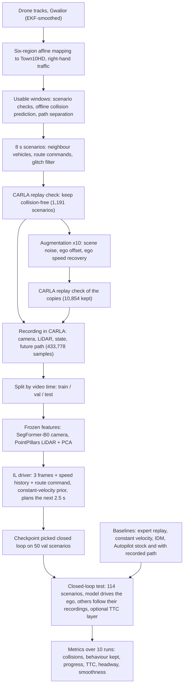

# While in London do as the Gwaliorites do: Style Transfer of Trajectories across Traffic Domains in Real-to-Sim

[](raj_vamsi_wafr.pdf)
[](https://www.python.org/)
[](https://carla.org/)
[](https://pytorch.org/)

Official repository for the research paper: **"While in London do as the Gwaliorites do: Style Transfer of Trajectories across Traffic Domains in Real-to-Sim"** by **Dasari Raj Vamsi** and **Rahul Kala** (*Center for Autonomous Systems, ABV-Indian Institute of Information Technology and Management Gwalior, India*).

> **Working on this repo?** Start with [`IL_STATUS.md`](IL_STATUS.md) (current status of the imitation-learning driver) and the dated decision log [`ML_DECISIONS.md`](ML_DECISIONS.md). The IL code is described in [`il/README.md`](il/README.md). The replay and collision work is in [`AGENTS.md`](AGENTS.md), [`HANDOVER.md`](HANDOVER.md), [`TEST_CHECKLIST.md`](TEST_CHECKLIST.md) and [`BUG_COLLISIONS.md`](BUG_COLLISIONS.md).

> **Status (November 2026).** The drone-to-CARLA mapping was corrected to right-hand traffic: the first matrices drove Gwalior traffic against Town10HD's lanes. All data was rebuilt, and a new imitation-learning driver (camera + LiDAR, `il/`) was trained on it and evaluated closed loop over 10 runs against five baselines (results below). The earlier SegFormer behavioural-cloning model and its January 2026 benchmark are superseded.

---

## 📌 Abstract & Overview

Autonomous driving (AD) systems are primarily developed and evaluated under American and European traffic environments, where rule-following behavior is standard and aggressive driving is rare. In contrast, traffic in developing regions (such as Gwalior, India)—characterized by heavy-tail behaviors, frequent overtaking, heterogeneous vehicle mix, and lack of strict lane discipline—is underrepresented.

This project introduces a **Real-to-Sim Style Transfer Framework** that transfers unorganized, aggressive real-world traffic trajectories recorded by high-altitude drones in India into simulated European/American urban environments (CARLA simulator, Town10HD). 

### Key Technical Highlights:
1. **Map-Aware Affine Transformation**: Maps drone pixel coordinates to CARLA Town10HD with six calibrated regions (one per road arm and direction) plus a blended centre, matching road lengths and widths. Since November 2026 the traffic keeps its real side relative to CARLA's right-hand lanes.
2. **Time-Synchronised Replay**: Vehicles follow their recorded trajectories on time (time-indexed PID with launch at the real speed), with physics on for every vehicle.
3. **Scenario Validation & Collision Handling**: Rejects unusable scenarios, predicts car contact, kerb and spawn failures offline, and keeps only scenarios that replay collision-free in CARLA.
4. **Ego-Centric Dataset with Augmentation**: 8 s scenarios with scene noise, ego offset and ego speed-recovery copies; each sample has camera, LiDAR, the ego's speed history, a route command and the future path.
5. **Imitation-Learning Driver** (`il/`): frozen SegFormer-B0 camera features and PointPillars LiDAR features, 3 frames, plus speed history and route command; predicts the next 2.5 s path on top of a constant-velocity prior.
6. **Closed-Loop Benchmark with a TTC Safety Layer**: the driver drives the ego while all other vehicles follow their recordings; compared with the expert replay, constant velocity, IDM and CARLA Autopilot (stock and given the recorded route), each with or without a time-to-collision layer, over 10 runs.
7. **Zero-Shot LLM Reasoning** (earlier work): pre-trained LLMs classify 15 s trajectory segments into maneuver categories.

---

## 🏗️ System Architecture



---

## 📁 Repository Structure

```
.
├── README.md                              # This file
├── IL_STATUS.md                           # Current status of the IL driver (read first)
├── ML_DECISIONS.md                        # Every decision and result, dated
├── AGENTS.md, HANDOVER.md                 # Replay pipeline: rules, settings, facts (October 2026)
├── BUG_COLLISIONS.md, TEST_CHECKLIST.md   # Collision investigation; checks a change must pass
├── requirements.txt                       # Python dependencies
├── start_carla.sh                         # CARLA 0.9.15 launcher
│
├── il/                                    # Imitation-learning driver (see il/README.md)
│   ├── build_scenarios_8s.py, augment_scenarios.py, replay_scenarios.py, record_samples.py
│   ├── cache_features.py, pointpillars.py # Frozen camera and LiDAR features
│   ├── model.py, train.py                 # Model and training
│   ├── closed_loop_multi.py               # Closed-loop evaluation, TTC layer, baselines
│   ├── metrics_v2.py, behaviour_v2.py, dist_v2.py, summary_runs.py
│   ├── idm.py, lead_input.py, probe_offline.py
│   └── run_*.sh                           # Chain scripts that ran each step
│
├── results/il_rhd_10runs/                 # 10-run evaluation: summary, spreadsheet, per-run tables
│
├── Real2Sim Trajectory & Map Alignment
│   ├── timemethod.py                      # Six region affine matrices, centre blending, region classification
│   ├── newtimemethod.py, convertion.py, automatic.py, prepare_data.py
│
├── Simulation & Control Engine
│   ├── scc.py                             # SimVehicle: time-indexed PID route tracking, in-gear launch
│   ├── scenario_generator.py, simulate_and_record_scenarios.py, SCENARIO.py
│
├── Scenario Validation & Collision Handling
│   ├── scenario_checks.py                 # Offline checks, TrackStore, box geometry
│   └── debug/                             # Audit, collision prediction, path separation, evidence rendering
│
├── Earlier pipeline (superseded)
│   ├── mine_*.py                          # 15 s trajectory mining
│   ├── export_llm_trajectories.py, query_zero_shot_llm.py, catalog_server.py, ...   # LLM tagging and catalog
│   └── train3.py, drive.py, modelrun.py, autopilotrun.py, compare3.py              # SegFormer BC and 3-way benchmark
│
├── archive/                               # Archived scripts (gitignored)
└── Scenariosssss/                         # Data and outputs (gitignored, about 70 GB)
```

---

## ⚙️ Prerequisites & Setup

### 1. Environment Requirements
- **OS**: Ubuntu 20.04 / 22.04 / 24.04 LTS (Linux)
- **GPU**: NVIDIA GPU with CUDA 11.8+ / 12.x support (12GB+ VRAM recommended for training; CARLA replays and camera videos were produced on a T1000 8 GB)
- **CARLA Simulator**: Version **0.9.15**
- **Data (not in git)**: `stabilize_ekf_final2.csv` (EKF-smoothed tracks, primary), `DJI_0003-002.MP4` (drone video), the behaviour CSVs in `Scenariosssss/<Behaviour>/`, and `stabilize_ekf_lv_final.csv` (leader-vehicle columns, used for vehicle following)

After a kernel update, make sure the NVIDIA module for the running kernel is installed (on Ubuntu: `linux-modules-nvidia-<version>-open-$(uname -r)`), otherwise CARLA cannot render.

### 2. Install Python Dependencies

Create a Conda environment and install the required packages:

```bash
conda create -n carla_env python=3.10 -y
conda activate carla_env
pip install -r requirements.txt
```

### 3. Launching CARLA Simulator

Use the included helper script to start the CARLA simulator server:

```bash
# Display mode (GUI window)
./start_carla.sh --display

# Headless / Offscreen mode (for server or background rendering)
./start_carla.sh --server

# No rendering at all (physics and collision sensor only; enough for scenario checks, no GPU needed)
~/CARLA_0.9.15/CarlaUE4.sh -nullrhi -nosound -carla-rpc-port=2000
```

---

## 🚀 Step-by-Step Usage Guide

### Step 1: Real-to-Sim Trajectory Mining & Alignment
Mine trajectory segments from the drone dataset and transform them to CARLA Town10 HD map coordinates:

```bash
python mine_15s_drone_catalog.py
python mine_unique_ego_catalog.py
```

### Step 2: Simulate Scenarios & Record Ego-Centric Dataset
Execute collision-aware PID simulation in CARLA to record monocular RGB camera images and ground-truth control actions (`speed`, `steering`):

```bash
python simulate_and_record_scenarios.py
```
This generates `metadata.csv` containing image paths and corresponding normalized control labels.

### Step 2b: Scenario Validation, Collision Prediction & Repair (current pipeline)
Validate the behaviour scenarios, predict collisions offline, repair small overlaps and replay in CARLA. Full details and expected numbers are in [`TEST_CHECKLIST.md`](TEST_CHECKLIST.md) and [`AGENTS.md`](AGENTS.md).

```bash
# Audit every candidate row of a behaviour CSV (rejects pedestrians / missing tracks / no CARLA path; reports warnings)
python debug/check_scenarios.py --audit-csv "Scenariosssss/Overtaking Left/overtaking.csv"

# Predict car contact, kerb hits and spawn failures for all scenarios (export the drivable map once, CARLA running)
python debug/predict_collisions.py --export-map
python debug/predict_collisions.py            # -> Scenariosssss/collision_prediction.csv

# How many small overlaps (>= -0.5 m) can be repaired with shifts <= 0.7 m
python debug/apply_separation.py --count

# Vehicle Following candidates (needs stabilize_ekf_lv_final.csv) and the full usable-scenarios table
python debug/mine_vehicle_following.py
python debug/count_usable_scenarios.py

# Build scenario folders and replay them headless in CARLA (collisions, gaps, progress)
python debug/make_validated_scenarios.py --input "Scenariosssss/Overtaking Left/overtaking_validated.json" --sample 5
python debug/check_scenarios.py --scenarios "Overtaking Left Validated" --carla --modes pid

# One complete scenario folder with drone video, trajectory images and CARLA bird's-eye videos (GPU server)
python debug/render_scenario_evidence.py --category "Overtaking Left" --ego 565 --other 1342 --start 853 --camera
```

### Step 3: Build the IL Dataset

All IL scripts are in `il/`; `il/run_rhd_*.sh` are the chain scripts with the exact settings used.

```bash
python il/build_scenarios_8s.py                                     # 8 s scenarios from the drone tracks
python il/replay_scenarios.py --yaw path --drive velocity --tag cureE   # keep the ones that replay collision-free
python il/augment_scenarios.py                                      # scene noise, ego offset, ego speed recovery
python il/record_samples.py --full --port 2000 --out <samples_dir>  # camera, LiDAR, state, future path (CARLA rendering)
python il/cache_features.py --samples <samples_dir> --feats <feats_dir> --device cuda
```

Pretrained weights are not in the repository; `il/README.md` lists them.

### Step 4: Train the IL Driver

```bash
python il/train.py --data <samples_dir>:<feats_dir> --name rhd_scratch --epochs 20 --epoch-samples 65536 \
    --modes 1 --lr 1e-4 --wd 0.05 --dropout 0.3 --feat-drop 0.2 --state speedhist --along-w 2
python il/select_ckpt_closed_loop.py      # pick the checkpoint closed loop on validation scenarios
```

### Step 5: Closed-Loop Evaluation

```bash
CL_TRAILS=<trails_dir> python il/closed_loop_multi.py --port 2000 --split test --tag eval \
    --drivers expert constvel+ttc:0.7:0.2 rhd_scratch@cl rhd_scratch@cl+ttc:0.7:0.2 autopilot autopilot_stock idm
python il/metrics_v2.py <trails_dir> --csv Scenariosssss/IL/closed_loop_eval.csv
python il/dist_v2.py <trails_dir>
python il/summary_runs.py <tag_run1> <tag_run2> ...    # mean, spread and paired differences over repeated runs
```

`+ttc:0.7:0.2` adds the time-to-collision layer (brake when a vehicle ahead is reached within 0.7 s, gap 0.2 m) to every vehicle.

---

## 📊 Evaluation & Results

### Closed-loop benchmark (November 2026, right-hand traffic)

114 test scenarios × 9 drivers × 10 runs. The driver drives the ego; every other vehicle follows its recorded path with physics on. Mean over the 10 runs; spread, paired comparisons and per-run tables are in [`results/il_rhd_10runs/`](results/il_rhd_10runs/).

| Driver | Ego collision % ↓ | Behaviour kept % (of 56) ↑ | Kept and no ego collision % ↑ | Progress ↑ | Median headway (s) |
| :--- | ---: | ---: | ---: | ---: | ---: |
| Expert (recording replayed) | 2.5 | 100 | 98.6 | 0.94 | 1.07 |
| IL driver + lead input + TTC | 1.1 | 66.6 | 65.0 | 0.62 | 1.85 |
| IDM | 25.6 | 74.6 | 62.9 | 0.80 | 1.46 |
| **IL driver + TTC** | **1.4** | **62.0** | **60.0** | **0.59** | **1.83** |
| Autopilot (recorded path + speed) | 9.1 | 68.8 | 60.0 | 0.54 | 1.91 |
| Constant velocity + TTC | 1.2 | 61.8 | 59.3 | 0.51 | 1.62 |
| IL driver + lead input | 36.3 | 58.6 | 38.0 | 0.72 | 1.11 |
| Autopilot (stock) | 6.3 | 42.7 | 38.0 | 0.62 | 1.44 |
| IL driver | 31.0 | 58.4 | 37.0 | 0.67 | 1.11 |

- **Behaviour kept:** same vehicle ahead at start and end, any pass on the same side, final gap within 5 m of the recorded one; checkable on the 56 scenarios where the recorded ego moves at least 5 m.
- **Lead input:** the ground-truth gap and closing speed to the vehicle ahead. It is privileged information, used as a test of whether the model can learn braking.
- **Findings:**
  - The IL driver on its own matches the real headway (1.11 s against 1.07 s) but crashes in 31 % of scenarios.
  - With the TTC layer it crashes in 1.4 %, but then it equals constant velocity + TTC on behaviour kept, while driving further (0.59 against 0.51).
  - The lead input adds about 5 points with the TTC layer (9 of 10 runs) and more collisions without it (10 of 10 runs).

### Scenario dataset (October 2026, before the right-hand-traffic correction)

Six behaviours, counted on all candidate rows (overlapping windows of the same event are not merged). A scenario is
**usable** when it involves no pedestrian, is at least 80 % inside the calibrated regions, passes the scenario checks,
and has no predicted car contact, kerb/median hit or spawn failure, after repairing small overlaps (≥ −0.5 m) with path
shifts of at most 0.7 m.

| Behaviour | Pass checks | Usable as recorded | Repaired by shift | **Usable** |
| :--- | ---: | ---: | ---: | ---: |
| Cut In | 26 | 22 | 0 | **22** |
| Cut Out | 150 | 118 | 13 | **131** |
| U-turn | 29 | 18 | — | **18** |
| Overtaking Left | 1,810 | 717 | 225 | **942** |
| Overtaking Right | 1,375 | 358 | 203 | **561** |
| Vehicle Following (4.2 s) | 1,822 | 1,026 | 212 | **1,238** |
| **Total** | **5,212** | **2,259** | **653** | **2,912** |

The offline collision prediction caught 20 of 20 problem scenarios in 45 random CARLA replays. Repaired scenarios with
shifts above ~0.5 m replay cleanly only about half the time, so those are checked in CARLA before use.

### Earlier benchmark results (January 2026, superseded)

The WAFR draft reported results from the earlier SegFormer behavioural-cloning model and `compare3.py`, before the collision fixes and the right-hand-traffic correction. They have not been reproduced and should not be used.

---

## 📝 Citation

If you find this work or codebase useful in your research, please cite our paper:

```bibtex
@article{vamsi2026london,
  title={While in London do as the Gwaliorites do: Style Transfer of Trajectories across Traffic Domains in Real-to-Sim},
  author={Dasari Raj Vamsi and Rahul Kala},
  journal={Preprint / Technical Report},
  year={2026},
  institution={Center for Autonomous Systems, ABV-IIITM Gwalior}
}
```

---

## 📄 License
This repository is licensed under the [MIT License](LICENSE).
